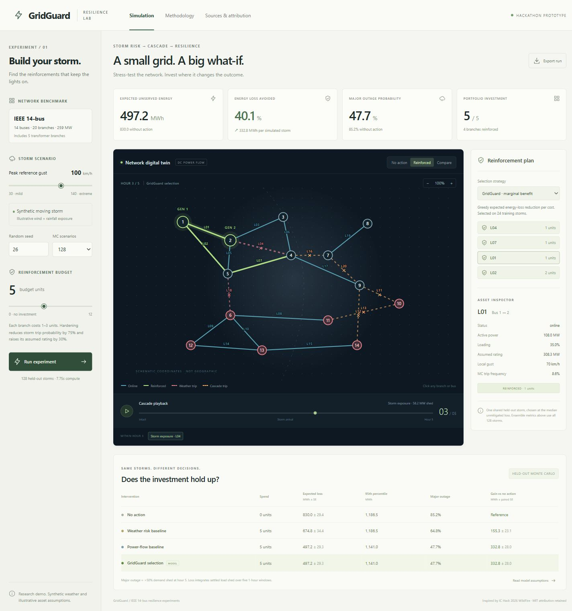

# GridGuard

**What happens to Great Britain's power grid when a storm hits, and which lines are worth reinforcing first?**

GridGuard is a storm stress-test for the GB transmission network, built in a weekend at OxHacks (24–25 October 2026). You place a storm on a map, and it simulates which lines fail, how the failures cascade, how long repairs take, and which reinforcements would have reduced the damage most.



## What it does

1. **Weather.** Pick a synthetic windstorm (track, strength, duration) or replay Storm Darragh (December 2024) from recorded gusts.
2. **Line damage.** Each line gets an hourly failure probability from its route, terrain and an engineering fragility curve for pylons.
3. **Cascade.** When lines fail, power is re-routed with a DC power-flow solve. Lines pushed over their rating trip, and the process repeats until the grid is stable or parts of it are islanded.
4. **Repair.** A limited number of crews fix lines hour by hour, and only when the wind allows.
5. **Decisions.** The same storm is re-run with different reinforcement plans on the same random draws, so plans are compared like for like. Each plan gets an energy-not-served figure and an illustrative cost-benefit ratio.

Alongside the simulation, a machine-learning model forecasts local power cuts near each line. It is shown as its own map layer.

## Architecture

```
frontend/       React + Vite map UI (storm editor, playback, decision panel)
backend/        Flask API
  storm.py, weather.py     storm generation and weather import
  simulation.py, grid_ops.py   failures, DC power flow, cascades, repairs
  decisions.py, planning.py    reinforcement plans and cost-benefit
  ml_risk.py, forecast.py, hybrid.py   serving the ML model
failure_model/  dataset build, XGBoost training, calibration, evaluation
demo_data/      network, Storm Darragh replay and the two saved models (27 MB)
scripts/        data builders and benchmarks
tests/          pytest suite
```

The network has 478 buses and 673 branches at 132–400 kV, built from OpenStreetMap routes. Line ratings, generation and demand are illustrative, not operator data.

## Run it

Needs Python 3.11+ and Node 20.19+.

```bash
python -m venv .venv
.venv/bin/python -m pip install -r requirements.txt
npm ci --prefix frontend
.venv/bin/python scripts/serve_preview.py
```

Open http://127.0.0.1:5001 and press **Simulate & compare**. Everything the demo needs is in `demo_data/`; no downloads, API keys or environment variables. With `make`, the same thing is `make install` then `make run`.

Tests:

```bash
.venv/bin/python -m pip install -r requirements-dev.txt
make test        # fast tests, about a minute
make test-all    # adds three full-storm simulations, about 8 minutes
```

`make train` rebuilds the dataset and retrains both models with a fixed seed. It needs an 18 GB data archive that is not in this repository; see [ML_NOTES.md](ML_NOTES.md).

## The ML model, and what it can and cannot do

An XGBoost classifier trained on 7.4 million line-hours (2015–2026) predicts the chance of a weather-caused fault report within 5 km of a line in the next hour. Scores on the final 25% of the period, which the model never saw in training (1,845,221 line-hours, 2,008 events):

| Model | Log loss | Average precision |
|---|---:|---:|
| Constant rate | 0.00853 | 0.001 |
| Wind-only logistic regression | 0.00702 | 0.043 |
| **XGBoost, calibrated** | **0.00650** | **0.077** |

It ranks risky hours far better than chance, but it under-predicts storm hours (547 faults expected against 950 observed) and it learned from distribution faults in northern Scotland, not from transmission failures. For that reason it does not drive the simulation by default. [ML_NOTES.md](ML_NOTES.md) has the full write-up, including the model's weaknesses.

## Challenges we ran into

- **There is almost no public data on transmission lines failing.** In 11.5 years of the fault register we used, only 24 weather faults were on 132 kV overhead lines. We could not train the model we set out to build, so we trained on local distribution faults near each line as a stand-in.
- **The stand-in model broke the simulation.** Fed in directly as line-failure probability, it failed 165 of 367 lines during Storm Darragh. In reality the transmission grid held. We moved the ML to its own layer and built a bounded "hybrid" mode in which it can only shift risk between similar lines.
- **The data was too big for a hackathon.** The raw grid, outage and weather archive is about 18 GB, and the weather API cut us off at its daily request limit part-way through. The repository carries a 27 MB demo subset.
- **The model misses the storms that matter most.** It is well calibrated on ordinary days and too low in severe ones, and it does not transfer between regions: on the Midlands and South West during Darragh its count was 3.4 times too low.
- **The network changed under the model.** The grid was rebuilt from 367 to 673 branches after training and the old line IDs were reused for different lines, so the model had to be matched to lines by geography.
- **Four people, four branches.** Map, simulation, data and model were built in parallel and merged at the end.

## What we would do next

- Test the model on lines it has never seen, not only on later dates.
- Score it with archived weather forecasts, as it currently assumes the weather is known in advance.
- Find real transmission outage records, which is the only fix for the stand-in target.
- Add AC power flow; the DC approximation ignores voltage.

## Team

Built by [@yeah-course](https://github.com/yeah-course), [@TimothyKa100](https://github.com/TimothyKa100), [@TheRealTrip](https://github.com/TheRealTrip) and [@michaelrmo](https://github.com/michaelrmo).

Data: OpenStreetMap contributors (ODbL), SSEN Distribution, Open-Meteo / ERA5, Met Office. See [ATTRIBUTION.md](ATTRIBUTION.md). Detailed design notes are in [docs/](docs/).
