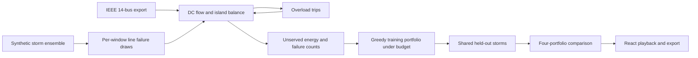

# Workflow and practical choices



## Mapping from the starting repository

| Inspected upstream | GridGuard adaptation |
| --- | --- |
| Flask `app.py` JSON routes | `backend/app.py`, same Flask/Python service boundary, bounded validated experiment requests |
| `create_grid`, `step`, `run_simulation` | `Network`, `solve`, `simulate`; real branch topology and electrical equations replace spatial fire propagation |
| Monte Carlo burn-count aggregation | Shared weather draws, per-line trip frequencies, energy-loss distributions and paired comparisons |
| React `WildfireSimulation` controls/play state | React storm picker, SVG map of the GB grid on a UK outline, continuous playback |
| `WildfireMitigation` zones then MC rerun | Discrete branch reinforcement, heterogeneous costs and marginal benefit selection |
| Next frontend and cross-origin Flask calls | React/Vite build served by Flask; relative API paths and optional Vite dev proxy |

The interface is implemented anew around grid decisions. Keeping NumPy and a small exact DC linear solve makes thousands of small cascade evaluations interactive. Pandapower supplies the benchmark and an independent intact DC reference. Running a mutable pandapower object for every greedy candidate and Monte Carlo trajectory would add overhead and complex island bookkeeping without adding AC physics to a DC model.

## API

`GET /api/health` reports model and synthetic weather status.

`GET /api/network?name=ieee14|gb` returns network data plus explicitly assumed ratings and map coordinates.

`GET /api/storms` lists the real storm files in `data/storms/` (built by `scripts/build_storm_benchmark.py`) (id, name, start, hours, outage feeds, outage count, peak gust) and returns the GB network the map draws.

`POST /api/storm` runs one seeded storm on the GB network: `{"scenario":"synthetic","peak_gust":160,"hours":36,"seed":1}` (peak gust 60–250 km/h, 6–72 hours), or `{"scenario":"<storm id>","seed":1}` to replay a real storm. It returns hourly `frames` (line status `online`/`pylon`/`overload`, where each pylon fell, flows, served load); real storms also return the hourly gust grid, the real outages, outage-feed coverage and a `benchmark` comparing timing and place.

`POST /api/experiment` accepts JSON integer fields (plus `network`, `mode`, `hours`, `crews`, `weather`, `storm_type`, `custom_lines` and `economics`; see `docs/MULTIDAY.md` and `docs/DECISION_SUPPORT.md`):

```json
{"intensity":100,"seed":26,"samples":128,"budget":5}
```

- `intensity`: 30–140 km/h reference gust.
- `seed`: 0–2147483647.
- `samples`: 16–512 (UI choices start at 64).
- `budget`: 0–12 illustrative units.

The response includes `config`, `model`, `network`, `weather`, `portfolios`, `optimization_trace`, example-selection rationale and runtime. Each portfolio includes a selected branch list, spending, ensemble metrics, paired gain/SE and frames for the same held-out scenario. Loss distributions are included for offline analysis. There is no persistent server session or shared RNG state. An in-process lock bounds computation to one experiment at a time; concurrent requests wait up to 120 s, then receive 429 with a retry message. A small in-memory LRU caches completed parameter sets and repeated electrical states.

## Electrical state transitions

1. Begin at the intact scheduled lossless dispatch.
2. Draw physical weather failures for currently surviving branches.
3. Find connected components, dispatch within available active-power capacity, and proportionally disconnect excess demand.
4. Solve the reduced nodal susceptance matrix in every energized component, with a separate reference angle per island. Validate active-power balance at every bus.
5. Simultaneously trip all branches whose absolute MW flow exceeds their current assumed rating. Re-enter step 3 until no overload remains.
6. Add the settled MW shed times one hour to energy not served. Continue the next exposure window with current surviving assets and disconnected loads.

Internal MW balance uses full precision; JSON frames round for display. The topology cache keys both active branches and remaining demand, because earlier disconnections affect later island states. Base-case shunt conductance, voltage magnitudes and reactive quantities do not enter this lossless DC formulation.

## Optimization and evaluation

The training bank uses `seed XOR 0xA51C`. Held-out storms use the selected seed. Every greedy candidate is evaluated against the same training weather and uniform trip draws. Every final portfolio is then evaluated against the same separate held-out draws. Sorting rules are deterministic for ties.

The objective is energy not served across the event, so investment can protect a modest direct-risk line whose loss causes a major electrical cascade. Simple risk ranking cannot see that consequence. The solver is deliberately free to report ties or worse performance for GridGuard on held-out data.

## Intended next engineering work

Use real asset geography and calibrated hazard inputs; add explicit transmission/transformer fragility classes; compare greedy with exact subset search on this tiny case; introduce critical-load priorities and restoration; validate contingency states with pandapower AC load flow; then add forecast/news adapters described in `INTEGRATIONS.md`. For larger networks, move experiments into background jobs with cancellation and progress reporting.
